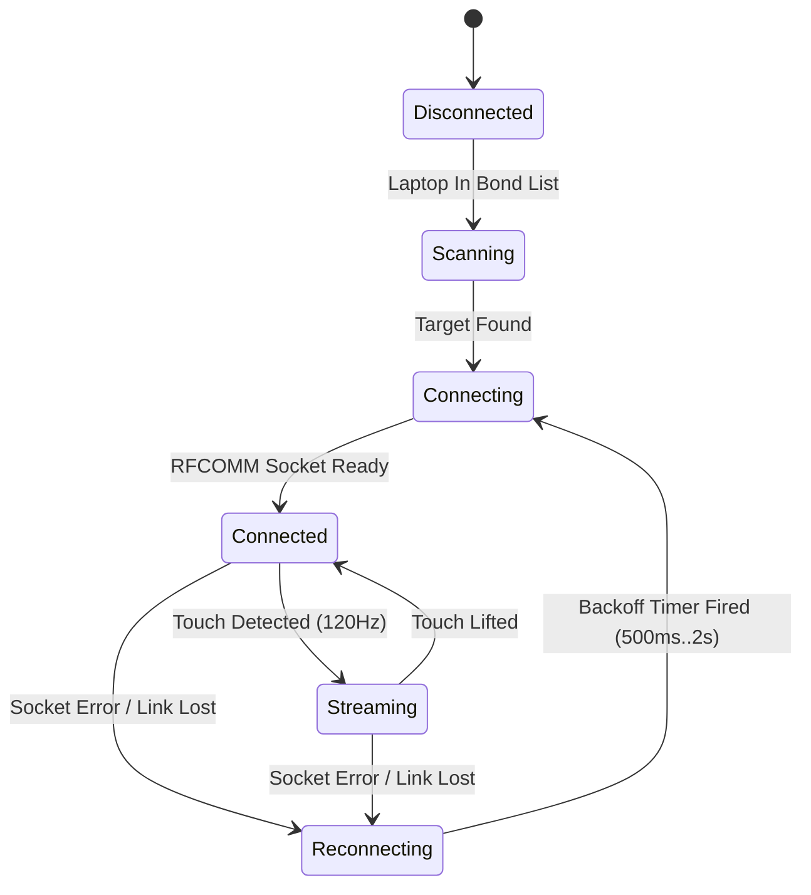

# PhonePad — Phase 1: Core MVP & RFCOMM Engine

**Author:** Pankoj Roy  
**Target Milestone:** Sub-30ms Trackpad MVP  
**Stack:** Rust (Host-side Daemon) + Flutter/Android (Client Touch Surface)  
**Transport:** Classic Bluetooth RFCOMM (Serial Port Profile / SPP)

---

## 1. Objective & Scope

Establish the baseline end-to-end pipeline:
1. Turn an Android phone into a dumb multi-touch capture surface.
2. Stream raw touch events as fixed 6-byte binary packets over classic Bluetooth RFCOMM.
3. Ingest packets on a lightweight Rust host running on the laptop, calculate velocity/acceleration, and inject native OS mouse and scroll events.
4. Achieve <30ms total latency, with automatic connection recovery within 2 seconds.

---

## 2. Micro-Binary Protocol Specification

To prevent serialization lag (JSON/Protobuf add 5–15ms parsing overhead), PhonePad uses a strict, zero-copy, 6-byte little-endian binary frame.

### 2.1 Packet Layout (6 Bytes)

| Offset | Field | Type | Description |
|---|---|---|---|
| `0x00` | `opcode` | `u8` | Event classification (see Opcode table) |
| `0x01..0x02` | `dx` | `i16` (LE) | Signed horizontal delta ($X_{t} - X_{t-1}$) |
| `0x03..0x04` | `dy` | `i16` (LE) | Signed vertical delta ($Y_{t} - Y_{t-1}$) |
| `0x05` | `flags` | `u8` | Bitmask: Finger count, touch state, click modifiers |

### 2.2 Opcode Definitions

| Opcode (`u8`) | Name | Description |
|---|---|---|
| `0x01` | `MOVE` | 1-Finger drag delta for cursor repositioning |
| `0x02` | `TAP_LEFT` | 1-Finger instantaneous tap (Left Click) |
| `0x03` | `TAP_RIGHT` | 2-Finger instantaneous tap (Right Click) |
| `0x04` | `SCROLL` | 2-Finger continuous delta for 2D scrolling ($dx$ = horiz, $dy$ = vert) |
| `0x05` | `DRAG_START` | Click-and-hold trigger (Left button down) |
| `0x06` | `DRAG_END` | Left button release |
| `0xFE` | `HEARTBEAT` | Keep-alive probe sent every 1000ms during idle periods |
| `0xFF` | `ACK` | Handshake acknowledgment and link ping response |

### 2.3 Flags Bitmask (`u8`)

- **Bit 0 (`0x01`):** Touch Active (1 = at least one finger on screen, 0 = all fingers lifted)
- **Bit 1..2 (`0x06`):** Finger Count (`00` = 0 fingers, `01` = 1 finger, `10` = 2 fingers, `11` = 3+ fingers)
- **Bit 3 (`0x08`):** Haptic Feedback Requested (echoed for client acknowledgment)
- **Bit 4..7:** Reserved for future phase extensions.

---

## 3. Host-Side Architecture (Rust)

The Rust host process runs as a headless asynchronous daemon utilizing `tokio`.

```
                    ┌────────────────────────┐
                    │ Classic Bluetooth SPP  │
                    │   (RFCOMM Channel 1)   │
                    └───────────┬────────────┘
                                │ Raw Byte Stream
                                ▼
                    ┌────────────────────────┐
                    │ tokio Async Buffer     │
                    │ (Zero-copy 6-byte frame│
                    └───────────┬────────────┘
                                │ Packet Struct
                                ▼
                    ┌────────────────────────┐
                    │ Host Gesture Engine    │
                    │ - Ballistic Curves     │
                    │ - Tap vs Drag Filter   │
                    │ - Sub-pixel Accumulator│
                    └───────────┬────────────┘
                                │ Computed Event
                                ▼
                    ┌────────────────────────┐
                    │ Native Input Injection │
                    │ - Windows: SendInput   │
                    │ - Linux: uinput/enigo  │
                    └────────────────────────┘
```

### 3.1 Crate Dependencies
```toml
[dependencies]
tokio = { version = "1.38", features = ["full"] }
byteorder = "1.5"
# Windows input injection
windows = { version = "0.58", features = [
    "Win32_UI_Input_KeyboardAndMouse",
    "Win32_Devices_Bluetooth",
    "Win32_Networking_WinSock"
] }
# Cross-platform fallback / Linux
enigo = { version = "0.2", default-features = false }
log = "0.4"
env_logger = "0.11"
```

### 3.2 Host Gesture & Acceleration Engine
Trackpad screens are small compared to laptop monitors. 1:1 pixel mapping makes cursor traversal painfully slow, while flat multipliers cause jitter. The host applies a **Non-Linear Ballistic Acceleration Curve**:

$$\Delta_{cursor} = \Delta_{raw} \times \left(1.0 + \text{Sensitivity} \times \left(\frac{\sqrt{\Delta x^2 + \Delta y^2}}{\text{Threshold}}\right)^\gamma\right)$$

- Slow finger drifts retain 1:1 sub-pixel precision for clicking small UI targets.
- Fast finger flicks multiply velocity up to $4.5\times$ to glide across 4K displays in one swipe.
- Host manages a sub-pixel floating accumulator so fractional remainders are preserved between frames.

---

## 4. Client-Side Architecture (Flutter / Android)

The mobile client is kept deliberately "dumb". It does not decide mouse acceleration or complex gestures; it acts as a low-latency digitizer and RFCOMM transmitter.

### 4.1 Touch Pipeline
- Utilizes Flutter `Listener` widget capturing raw pointer hooks (`onPointerDown`, `onPointerMove`, `onPointerUp`, `onPointerCancel`).
- Tracks active pointers in a hash table `Map<int, PointerEvent>`.
- Calculates pointer deltas relative to previous frame:
  $$\Delta x = \text{round}(P_t.x - P_{t-1}.x), \quad \Delta y = \text{round}(P_t.y - P_{t-1}.y)$$
- Batches and immediately flushes down the open RFCOMM socket without await stalls.

### 4.2 Bluetooth RFCOMM Handshake
- **Android UUID:** Standard SerialPortServiceClass UUID:
  `00001101-0000-1000-8000-00805F9B34FB`
- Establishes connection to bonded host laptop.
- Sets socket output stream buffer to minimum MTU for zero packet queuing delay.

---

## 5. Reliability & Auto-Reconnect State Machine



- When connection drops (phone locked or walks away), the host socket enters a non-blocking retry loop.
- Client catches `IOException` / socket disconnect and enters background scan with 500ms initial retry, backing off to 2000ms max.
- Connection restored automatically without manual user re-pairing.

---

## 6. Implementation Checklist & Acceptance Criteria

- [ ] **Protocol Parser Unit Tests:** Rust unit test verifying packet serialization, negative delta signedness, and flag bitwise extraction.
- [ ] **RFCOMM Listener:** Rust Windows WinSock / BlueZ listener accepting incoming client socket.
- [ ] **Pointer Digitation:** Flutter `Listener` streaming 6-byte frames at display refresh rate (60Hz–120Hz).
- [ ] **1-Finger Drag & Ballistics:** Smooth cursor movement across single and multi-monitor setups without cursor stalling.
- [ ] **Tap-to-Click:** 1-finger tap trigger (<180ms contact, <10px displacement) generates clean Left Click.
- [ ] **2-Finger Scroll:** Natural vertical and horizontal scroll injection.
- [ ] **2-Finger Tap:** Clean Right Click injection.
- [ ] **End-to-End Latency Target:** High-speed camera / software timestamps confirm touch-to-screen delay < 30ms.
