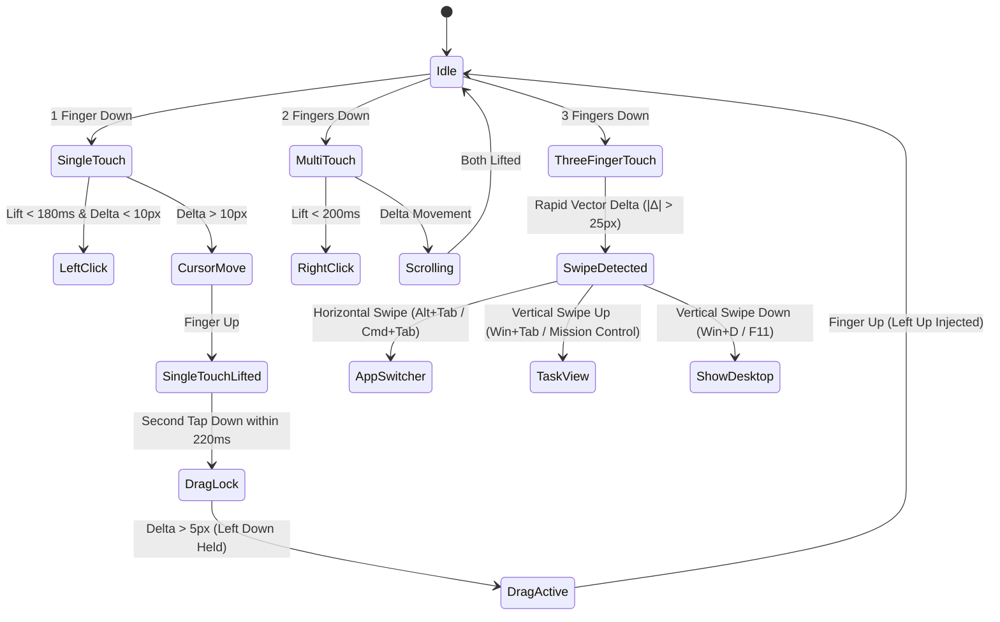

# PhonePad — Phase 2: Advanced Gestures & Host Companion

**Author:** Pankoj Roy  
**Target Milestone:** Native Trackpad Feel & Desktop Tray Integration  
**Dependencies:** Phase 1 Core MVP Verified  
**Stack:** Rust Host Companion + Flutter Client with Enhanced Haptic Feedback  

---

## 1. Overview & Goals

Transform PhonePad from a basic cursor pointer into an Apple Magic Trackpad-tier tactile experience:
1. Implement complex 3-finger multi-touch gestures host-side without complicating the mobile app.
2. Add tap-and-hold drag-locking with micro-deadzones.
3. Integrate physical haptic confirmation on the phone so clicks feel physically real.
4. Build a lightweight Rust desktop system tray companion for live telemetry, connection control, and sensitivity adjustment.

---

## 2. Advanced Multi-Touch Gestures (Host FSM)

The mobile client continues to transmit raw finger counts and delta vectors. The **Host Finite State Machine (FSM)** handles temporal gesture recognition.



### 2.1 3-Finger System Gestures (Per-OS Mapping)

| Gesture Direction | Windows Injection | Linux (X11 / Wayland) | macOS (Phase 2+) |
|---|---|---|---|
| **Swipe Left / Right** | `Alt + Shift + Tab` / `Alt + Tab` | `Super + Tab` | `Ctrl + Left/Right` (Desktop switch) |
| **Swipe Up** | `Win + Tab` (Task View) | `Super` (Overview) | `F3` (Mission Control) |
| **Swipe Down** | `Win + D` (Show Desktop) | `Super + D` | `F11` (Show Desktop) |

### 2.2 Drag-Lock Timing & Deadzone
- **Trigger:** Rapid double-tap where finger remains on surface after second tap.
- **State:** Injects OS `LEFTDOWN`. Moving the finger drags the selection/window.
- **Release:** Lifting the finger for >250ms triggers `LEFTUP`. Brief finger repositioning within 250ms preserves the drag lock (crucial for long drag selections across large displays).

---

## 3. Mobile Tactile Haptic Engine

Because phone screens lack physical mechanical switches, users rely on tactile cues to know an action was triggered without staring at their hands.

### 3.1 Haptic Profile Matrix

| Action | Feedback Pattern | Flutter API Implementation |
|---|---|---|
| **Left Click (1-Finger Tap)** | Crisp, sharp click impulse | `HapticFeedback.lightImpact()` |
| **Right Click (2-Finger Tap)** | Firm, double-resonant pulse | `HapticFeedback.mediumImpact()` |
| **Drag Lock Engaged** | Sustained heavy notch bump | `HapticFeedback.heavyImpact()` |
| **3-Finger Swipe Triggered** | Quick selection tick | `HapticFeedback.selectionClick()` |
| **Connection Established** | Double victory pulse | Custom 2-burst vibrator sequence |

---

## 4. Desktop System Tray Companion (Rust)

A minimal, zero-bloat background companion application replacing clunky Electron trays.

### 4.1 Tech Stack
- **Tray & Menu:** `tray-icon` crate (native Win32 / AppIndicator tray integration).
- **Event Loop:** Integrates directly with `tokio` and `winit` event polling.
- **Resource Footprint:** < 18MB RAM idle, 0% CPU when not streaming.

### 4.2 Tray Menu Layout & Features

```
┌──────────────────────────────────────────────┐
│  PhonePad Host — v1.1.0                      │
├──────────────────────────────────────────────┤
│  ● Status: Connected (Google Pixel 4a)       │
│  📶 Signal: -58 dBm (RFCOMM 120Hz)           │
│  ⚡ Latency: 14ms                             │
│  🔋 Phone Battery: 78% (Idle)                │
├──────────────────────────────────────────────┤
│  Sensitivity Preset:                         │
│    [ ] Precision (0.75x)                     │
│    [✓] Balanced  (1.00x)                     │
│    [ ] Agile 4K  (1.40x)                     │
├──────────────────────────────────────────────┤
│  Scroll Inversion: [✓] Natural  [ ] Standard │
│  Haptics Echo:     [✓] Enabled               │
├──────────────────────────────────────────────┤
│  Open Dashboard...                           │
│  Disconnect Device                           │
│  Quit PhonePad                               │
└──────────────────────────────────────────────┘
```

---

## 5. Heartbeat & Link Quality Monitoring

To detect "silent link drops" (e.g. phone screen timed out, Bluetooth radio sleep), the host and client exchange continuous lightweight health metrics.

### 5.1 Protocol Extension
- Client sends `0xFE` (`HEARTBEAT`) every 1000ms if no touch packet is streamed.
- Packet carries phone battery percentage (`u8`) and active screen brightness in the flags byte.
- Host watchdog timer resets upon every received packet. If 2500ms elapse with zero packets:
  1. Host flags status as `Link Lost`.
  2. Disengages any held mouse buttons (safety release: prevents stuck left-click).
  3. Re-enters RFCOMM listening state for client reconnection.

---

## 6. Implementation Checklist

- [ ] **Host Gesture FSM:** Implement time-windowed gesture recognizer for 3-finger horizontal and vertical swipes.
- [ ] **Tap-and-Hold Drag Lock:** Implement sub-250ms double-tap hold state with left-click latch and safety timer.
- [ ] **Flutter Haptics Engine:** Bind low-latency Android haptics to touch release recognition.
- [ ] **Rust Tray Companion:** Wire `tray-icon` with background `tokio` thread and dynamic menu updates.
- [ ] **Heartbeat Watchdog:** Rust timer detecting dropped packets and auto-clearing mouse button lock states.
- [ ] **Battery & RSSI Telemetry:** Mobile client embeds battery state in heartbeat frame, host tray displays live percentage.
